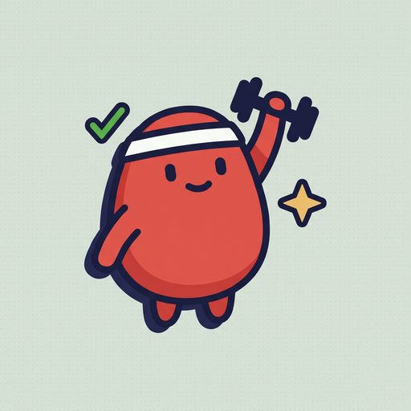

<div align="center">



# yool

**An offline-first daily health tracker for Android.**

Log your weight, food, workouts, sleep, steps and mood in one place,
pull in what your other apps already know through Health Connect,
and see what actually moves the needle.


[Features](#features) ·
[Design](#design-tracknix) ·
[Architecture](#architecture) ·
[Data sources](#data-sources-and-priority) ·
[Getting started](#getting-started) ·
[Backup and export](#backup-restore-and-export) ·
[Project structure](#project-structure) ·
[Roadmap](#roadmap)

</div>

---

## Why yool?

Most health apps track one thing well and lock it away. yool brings the daily numbers together so you can compare them.

- **One diary for the whole day.** Weight, calories, protein, steps, sleep, workouts, mood and binge days sit on a single screen.
- **Your data stays on your phone.** There's no account and no server. Everything lives in a local Room database, and you can back it up to a JSON file you control.
- **It works with the apps you already use.** Steps, sleep, nutrition and exercise sessions come in through Health Connect, so yool doesn't have to replace your watch or scale app.
- **Answers, not just charts.** Insights compare your days with each other. For example, how your mood changes after a short night, or what tends to come before a binge.

---

## Features

### Today
- A summary card for the day: weight, calories and protein against target, steps, sleep and workout status.
- A quick **evening check-in** for mood (1 to 5), binge (with a trigger tag such as *Stress*, *Social*, *Boredom* or *Tired*, or a custom tag) and a short note.
- A **binge-free streak** counter.
- A calendar button opens **History**, where you can review and edit any past day.

### Food diary
- Breakfast, lunch, dinner and snack sections with a running calorie and protein total.
- A personal **food library** of your own foods, each with serving sizes.
- **Saved meals**: log a group of foods you eat often with one tap.
- Search the library and log by serving, with quick-entry parsing for amounts.
- Foods imported from a MyFitnessPal history are kept apart from foods you created.

### Workouts
- **Templates** organised in folders, with an editor for exercises, set types and supersets.
- A live **workout session** with a rest timer (auto-start, sound and vibration), "previous" values from your last session, and the screen kept awake.
- Set types: **normal, warm-up, drop set and failure**.
- Exercise types for barbell, dumbbell, machine/cable, weighted and assisted bodyweight, reps only, cardio and duration.
- A **plate calculator** (configurable bar and plate set) and a **warm-up set generator**.
- **Personal records** for heaviest weight, best estimated 1RM and best set volume, flagged as you hit them.
- An exercise library with history, records and progress charts per exercise.
- **Strong CSV import**: share a Strong export to yool, or open it from a file manager, to bring in your whole workout history.

### Body measurements
- Body fat % plus circumference measurements for the neck, shoulders, chest, arms, waist, legs and more.
- A per-part history with change since the last entry, plus charts.

### Progress and insights
- Charts for every metric with **1W / 1M / 3M / 1Y / All** ranges or a custom date range.
- **Target adherence**: the share of days you hit your calorie, protein, step and sleep targets.
- **Weight trend**: your actual kg per week compared with the rate needed to reach your goal weight, with an *on track* / *off track* verdict.
- **Sleep and next-day mood**, **steps and mood**, and **workout days compared with rest days** (mood and calories).
- **Binge analysis**: calories and sleep on the day before, mood, and the most common triggers.
- Insights only draw conclusions once there's enough data in each group.

### Targets
- Targets for goal weight, calories, protein, steps and sleep.
- Targets are **versioned by date**, so raising your protein goal today doesn't rewrite how last month is judged.

### Reminders
- Morning **weigh-in** reminder, plus a follow-up only if you still haven't logged your weight.
- Evening **check-in** reminder, plus a follow-up only if the check-in is still open.
- Each reminder has its own time, and reminders are rescheduled after a reboot or time-zone change.

---

## Design: Tracknix

yool uses **Tracknix**, a neo-brutalist design system: thick ink borders, hard offset shadows with no blur, a sage, coral, green and amber palette, a dot-grid background and **JetBrains Mono** throughout.

The interface follows three rules, written down in [`docs/tracknix-ux-brief.md`](docs/tracknix-ux-brief.md):

1. **Summary first.** The top of every screen answers "how am I doing?" at a glance.
2. **Details on demand.** Long lists, source tags and explanations sit behind collapsible sections, dialogs or "Show all".
3. **One primary action.** Each screen has at most one coral button.

Every metric has its own muted color, which is used the same way on every screen, chart and tile.

The app's mascot is **Yoo**, a small coral bean in a sweatband who shows up every day.

---

## Architecture

yool is a single-module Android app built on **MVVM** over a repository layer, with a pure-Kotlin domain layer for all of the math.

```
┌──────────────────────────────────────────────────────────────┐
│  UI         Jetpack Compose (Material 3 + Tracknix components)│
│             ViewModels · Navigation Compose                   │
├──────────────────────────────────────────────────────────────┤
│  Domain     DayResolver · Stats · Insights · Streaks          │
│             Targets · FoodMath · WorkoutMath · MeasurementMath│
├──────────────────────────────────────────────────────────────┤
│  Data       Tracker · Food · Workout · Measurement repositories│
├──────────────────────┬───────────────────────────────────────┤
│  Local store         │  Integrations                         │
│  Room (SQLite, v4)   │  Health Connect · Strong CSV          │
│  DataStore prefs     │  WorkManager sync · AlarmManager       │
└──────────────────────┴───────────────────────────────────────┘
```

| Concern | Implementation |
|---|---|
| UI | Jetpack Compose, Material 3, custom Tracknix component set |
| Navigation | Navigation Compose, five tabs: Today, Food, Workout, Progress, Settings |
| Dependency injection | A small hand-written `AppContainer`, with no framework |
| Database | Room 2.8.5 (schema version 4) with KSP |
| Preferences | DataStore (reminders, Health Connect, workout settings) |
| Background sync | WorkManager periodic job (every 24 h), plus pull-to-refresh on Today |
| Health data | Health Connect client 1.1 |
| Serialization | kotlinx.serialization (backup format) |

### Data model

```
daily_entry          one row per day of things you typed: weight, mood, binge, note …
imported_value       (date, metric, source) → value pulled from outside sources
target               versioned targets, keyed by (metric, effectiveFrom)

food ──< food_log_entry                saved_meal ──< saved_meal_item >── food

exercise ──< workout_exercise >── workout          workout_set
          └< template_exercise >── workout_template ── template_folder
                                                    template_set

lift_best_set        best set per exercise per day (charts and export)
body_measurement     (date, part) → cm or %
```

Day totals are **never stored twice**. Calories and protein come from the food log, and the workout flag comes from the workout log. Both are worked out when a day is read, so editing an entry updates every screen at once.

---

## Data sources and priority

A single day can have a value for the same metric from several places. `DayResolver` picks one using a fixed priority. The lowest number wins:

| Priority | Source | Examples |
|:---:|---|---|
| 0 | **Manual** | A weight you typed |
| 1 | **yool logs** | Food diary totals, finished workouts |
| 2 | **MyFitnessPal** | Nutrition written to Health Connect by MyFitnessPal |
| 3 | **Health Connect** | Steps (e.g. Google Fit), sleep (e.g. Mi Fitness), exercise sessions; Strong CSV |
| 4 | **Migrated** | One-off history imports, used only to fill gaps |

Health Connect record types read: `StepsRecord`, `SleepSessionRecord`, `NutritionRecord` and `ExerciseSessionRecord`. yool only **reads** from Health Connect and never writes to it.

---

## Getting started

### Prerequisites

| | |
|---|---|
| JDK | 17 (Android Studio's bundled JBR works) |
| IDE | Android Studio with AGP 9.2 support |
| Device | Android 10 (API 29) or newer |
| Optional | Health Connect installed and set up on the device |

### Build and install

1. Clone the repository and open the project folder in Android Studio.
2. Let Gradle sync.
3. Run the `app` configuration on a device or emulator, or use the command line:

```bash
./gradlew installDebug
```

### First run

1. Open **Settings → Targets** and set your goal weight, calories, protein, steps and sleep.
2. Open **Settings → Health Connect** and grant the permissions you want. yool works without them, but steps and sleep will then have to be typed in.
3. Optional: in **Settings → Reminders**, turn on the weigh-in and check-in reminders.
4. Optional: share a **Strong** CSV export to yool to import your workout history.

---

## Backup, restore and export

| Feature | Where | Format |
|---|---|---|
| **Backup** | Settings → Data | One JSON document with everything: days, imports, targets, foods, food log, saved meals, exercises, templates, workouts and measurements |
| **Restore** | Settings → Data | Merges into the current data and **never overwrites anything you typed**. Restoring the same file twice doesn't create duplicates. |
| **Export** | Settings → Data | A ZIP for a chosen date range with `daily.csv`, `lifts.csv` and a Markdown `summary.md`, ready for a spreadsheet or an AI assistant |

The full backup schema, including the merge rules for each section, is documented in [`docs/backup-format.md`](docs/backup-format.md). Files from older versions (v1 to v3) still restore.

You can also convert history from other apps to this format and restore it as a one-off migration.

---

## Project structure

```
yool/
├── app/src/main/java/com/yatharth/yool/
│   ├── AppContainer.kt          # Manual dependency wiring
│   ├── MainActivity.kt
│   ├── data/
│   │   ├── db/                  # Room entities, DAOs, YoolDatabase (schema v4)
│   │   ├── healthconnect/       # Health Connect manager, record mapping, permission rationale
│   │   ├── model/               # Metric, Source, TargetMetric, ExerciseType, MeasurementPart …
│   │   └── *Repository.kt       # Tracker, Food, Workout, Measurement
│   ├── domain/                  # Pure Kotlin: day resolution, stats, insights, streaks, workout math
│   ├── io/
│   │   ├── backup/              # JSON backup / restore
│   │   ├── export/              # CSV + Markdown ZIP export
│   │   └── strong/              # Strong CSV parser and importer
│   ├── reminders/               # Scheduling, notifications, boot receiver
│   ├── sync/                    # Health Connect sync engine, policy, WorkManager worker
│   └── ui/
│       ├── components/          # Tracknix component set (cards, buttons, pickers, dialogs)
│       ├── theme/               # Colors, typography, dot-grid background
│       ├── day/ history/        # Today and History
│       ├── food/                # Diary, library, saved meals, editors
│       ├── workout/             # Active session, templates, exercise library, history
│       ├── measurements/
│       ├── graphs/ insights/    # Progress tab
│       ├── settings/            # Settings hub and sections
│       ├── importer/            # Strong CSV share/open target
│       └── navigation/
├── app/src/test/                # Unit tests
└── docs/
    ├── backup-format.md         # Backup JSON schema and merge rules
    ├── tracknix-ux-brief.md     # Design and UX rules
    └── images/
```

---

## Testing

The domain, I/O and sync-policy layers are plain Kotlin and covered by JVM unit tests:

```bash
./gradlew testDebugUnitTest
```

The tests cover day resolution and source priority, stats and insights, streaks, food and saved-meal math, workout math (1RM, PRs, plates, warm-ups), measurement math, backup round-trips, CSV export, the Strong import, Health Connect record mapping, reminder scheduling, the sync policy and date formatting.

---

## Roadmap

- [ ] Google Takeout import for historical step data
- [ ] Home-screen widget for the day's summary
- [ ] Dark theme
- [ ] Signed release builds

---

## Contributing

yool is a personal project, but issues and suggestions are welcome. If you open a pull request:

1. Branch from `main`.
2. Keep commits small and focused, using [Conventional Commits](https://www.conventionalcommits.org/) with a scope, for example `feat(food): …` or `fix(sync): …`.
3. Follow the Tracknix rules in `docs/tracknix-ux-brief.md` for any UI change.
4. Make sure `./gradlew :app:compileDebugKotlin` and `./gradlew testDebugUnitTest` pass.

---

## Disclaimer

yool is a personal tracking tool, not a medical device. Nothing it shows is medical advice. Talk to a qualified professional about your health, diet or training.

## License

No license has been chosen yet. Until one is added, all rights are reserved by the author.

## Acknowledgements

- [Jetpack Compose](https://developer.android.com/compose)
- [Health Connect](https://developer.android.com/health-and-fitness/guides/health-connect)
- [Room](https://developer.android.com/training/data-storage/room) and [WorkManager](https://developer.android.com/topic/libraries/architecture/workmanager)
- [JetBrains Mono](https://www.jetbrains.com/lp/mono/)

<div align="center">

Made with Kotlin by [Yatharth](https://github.com/yath-rth)

</div>
